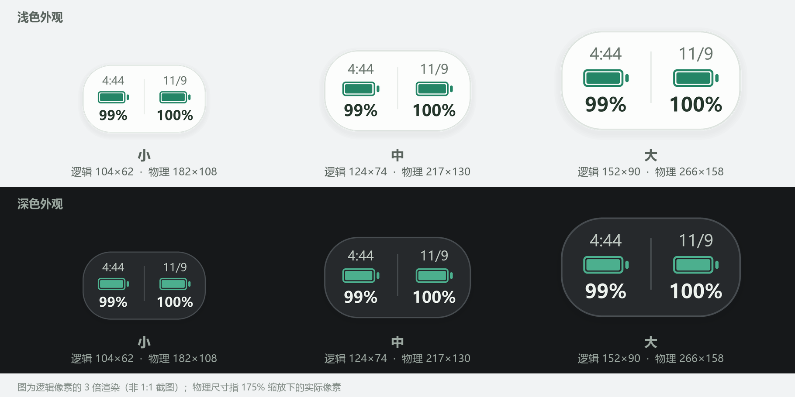
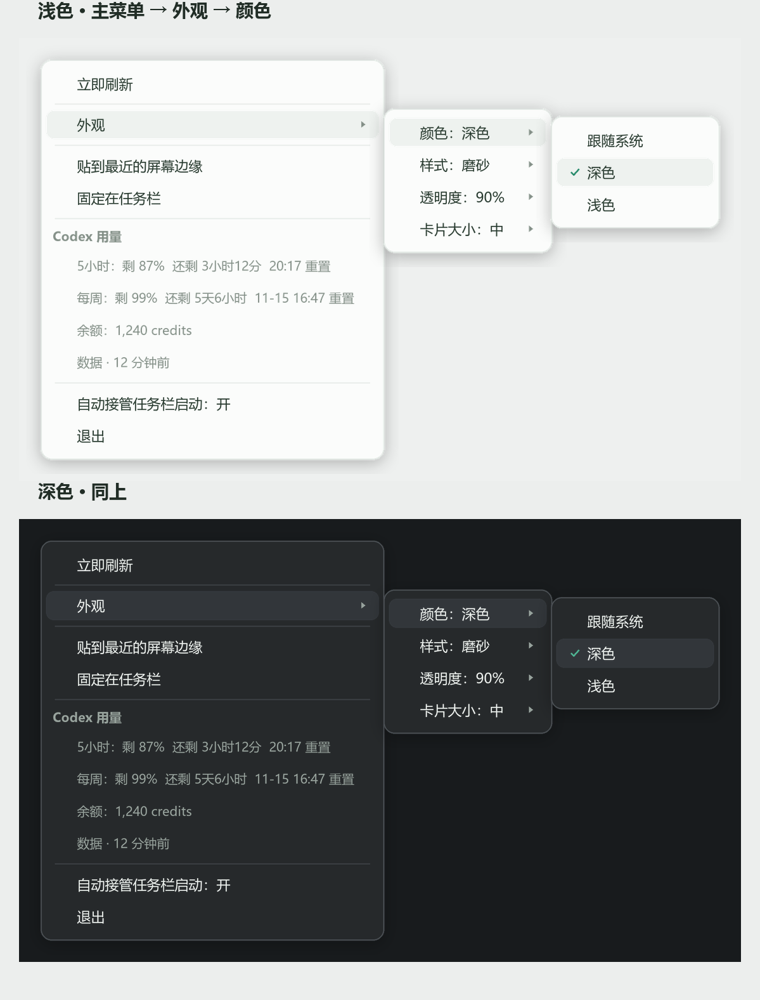
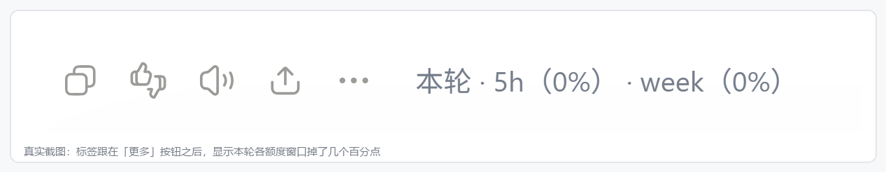

# Codex 用量 Suite

把 Codex 的 **5 小时 / 每周额度** 做成随时看得见的东西：一个贴着屏幕边缘的桌面悬浮窗，加上直接写进对话页的「本轮消耗」标签。

一套代码，两条输出线，共用一个只读日志的用量解析内核。**不联网、不读凭证、不上传任何数据。**

<p align="center">
  
</p>

---

## 1. 它解决什么问题

Codex 的额度消耗很快，但剩余量只有点开侧栏才看得到。这两条产品线分别解决「不想切窗口」和「想知道这一轮花了多少」：

| 痛点 | 对应产品线 |
| --- | --- |
| 写着代码突然被限流，才知道 5 小时窗口用完了 | 桌面悬浮窗：常驻显示剩余百分比，胶囊形态几乎不占地方 |
| 不知道某一次长回答到底吃掉多少额度 | 对话页标签：每轮回答的操作行后面直接标 `本轮 · 12.3k tokens · 5h -4%` |
| 想回溯「今天什么时候用超的」 | 托盘悬停显示重置时间、余额、上次使用时间 |

---

## 2. 两条产品线

### 2.1 桌面悬浮窗（`codex_usage_watch.py` + `float_win32.py` + `menu_win.py` + `menucanvas.py` + `tray_win32.py`）

- **胶囊 → 卡片**：默认是只有两个进度条的胶囊，鼠标移上去展开成完整卡片（剩余量、重置时间、余额、上次使用）
- **贴边收纳**：拖到屏幕左右边缘自动吸附，收起时只留一条 9px 的窄条
- **完全自绘**：分层窗口（`UpdateLayeredWindow`）按物理像素 1:1 渲染，不依赖任何 UI 框架；右键菜单也是自绘的三级菜单，浅/深色跟卡片联动
- **外观可调**：颜色（跟随系统/深/浅）、样式（原始 / 磨砂）、透明度、卡片大小
- **托盘常驻**：托盘图标本身就是剩余百分比，托盘右键菜单与悬浮窗菜单同源

三级菜单（外观 ▸ 颜色 ▸ 跟随系统/深色/浅色）的层级定位与贴边翻转：

<p align="center">
  
</p>

### 2.2 对话页「本轮消耗」标签（`codex_usage_watch.py` 里的 `TAG_JS` / `cdp_push` / `cdp_loop` + `cdp2.py`）

通过 Chrome DevTools Protocol（`--remote-debugging-port=9222`）注入一段 JS，把一行用量文字写进**最新一条回答**的动作行里——紧跟在「更多」按钮之后。

<p align="center">
  
</p>

标签内容是 `本轮 · 5h（-4%） · week（-1%）`：每个额度窗口这一轮掉了几个百分点。变化不足 1% 显示 `-<1%`，没有变化显示 `0%`，拿不到上一轮基线时显示 `—`。

> 上面这张是真实截图（已裁去正文）。截图时该轮已结算完、窗口数值没再变化，所以显示的是 `0%`；正常聊天里你会看到 `-4%` 这种。

更新时机是每轮结束（`task_complete`）；App 被重开后先用 `（0%）` 占位，等下一轮真实消耗覆盖，这样你打开历史对话时标签立刻就在。

几个实现上的坑，已经处理好了：

1. **多渲染进程**：App 可能同时存在主窗口、分离窗口和隐藏常驻窗口，只有一个是你正在看的。按「有消息行 + 可见 + 行数」打分选出正确目标，否则标签会全部写进一个看不见的窗口。
2. **虚拟滚动**：会话很长时部分行是 0 高度的未布局节点，必须筛掉，否则标签会写到视口外。
3. **React 重渲染**：切换会话、重新渲染都会把注入的节点冲掉，所以 `cdp_loop` 每 5 秒守一次，发现没了就补回去。
4. **端口没开不报错**：App 没以调试端口启动时静默跳过，不影响悬浮窗本身工作。

---

## 3. 快速开始

### 3.1 环境

- Windows 10 / 11（用到了分层窗口、托盘、Windows Toast）
- Python 3.9+（开发与测试环境为 3.13）
- 已安装并登录 **Codex 桌面版 / ChatGPT 桌面版**

### 3.2 安装

```bash
git clone https://github.com/Yuki-happyday/codex-usage-suite.git
cd codex-usage-suite
pip install -r requirements.txt
```

> 用 `pythonw.exe` 启动才不会弹黑框。如果 `pythonw.exe` 不在 PATH 里，改 `启动 Codex 用量提示.vbs` 顶部的 `Const PYW` 为绝对路径。
>
> 小提示：Windows 11 的托盘可见性是按「exe 路径 + 图标身份」记录的，**换解释器路径会让图标重新掉进折叠区**。选定一个解释器后尽量别改。

### 3.3 只想用悬浮窗

双击 `启动 Codex 用量提示.vbs`。没有可执行文件、没有安装包，就是一个 `.vbs` 拉起 `pythonw`。

### 3.4 还想用对话页标签

1. 双击 `make_lnk.vbs` → 生成「ChatGPT（带用量标签）.lnk」，以后**用它启动 ChatGPT**（带了 `--remote-debugging-port=9222`）
2. 双击 `启动 ChatGPT（带用量标签）.vbs` → 脚本会检查 9222 端口，没开就按需重启 ChatGPT，就绪后拉起监听程序

> 如果 ChatGPT 已经在跑但没开调试端口，脚本会先问你要不要关掉重开——输入框里没发送的内容会丢，所以给了确认框。

### 3.5 开机自启

`Win + R` → 输入 `shell:startup` → 把 `启动 Codex 用量提示.vbs` 的**快捷方式**丢进去。

---

## 4. 目录结构

```
codex-usage-suite/
├── codex_usage_watch.py      # 主程序：日志解析、状态、通知、托盘、菜单、CDP 注入
├── float_win32.py            # 分层窗口：胶囊/卡片绘制、贴边吸附、拖动、光标
├── menu_win.py               # 自绘菜单：多级面板、鼠标捕获派发、异步回调
├── menucanvas.py             # 菜单绘制：主题色板、悬停高亮层、命中测试
├── tray_win32.py             # 托盘图标与折叠区处理
├── cdp.py / cdp2.py          # 极简 CDP 客户端（cdp2 走 browser endpoint，支持多 target）
├── 启动 Codex 用量提示.vbs          # 只启悬浮窗
├── 启动 ChatGPT（带用量标签）.vbs   # 确保调试端口 + 启悬浮窗
├── make_lnk.vbs              # 生成带调试端口的快捷方式
├── requirements.txt
├── tools/                    # 开发期验证脚本（预览出图、真机校验、光标探测）
└── docs/screenshots/         # 组件样张与真实截图
```

> 核心 5 个模块必须与主程序同目录平铺——`pythonw` 直接以脚本方式启动，`import float_win32` 这类同目录导入不能挪进包。

---

## 5. 工作原理

1. **监听日志**：只读 `~/.codex/sessions/**/rollout-*.jsonl`，增量读（`state.json` 记每个文件读到的字节偏移），找 `event_msg` 里的 `token_count` 事件
2. **解析额度**：`rate_limits.primary`（300 分钟 = 5 小时窗口）、`rate_limits.secondary`（10080 分钟 = 每周）、`credits` 余额，字段为 `used_percent` + 重置时间
3. **累计本轮**：`task_started` 清零，`token_count` 累加 input/output/cached/reasoning，`task_complete` 时结算 → 弹通知 + 更新悬浮窗 + 推 CDP 标签
4. **过期保护**：重置点已过期的日志不参与计算，避免显示成「旧窗口形状」的错误百分比
5. **状态持久化**：`state.json` 只存偏移量、外观偏好、窗口位置，不含任何对话内容

---

## 6. 已知限制

1. 依赖 Codex 桌面版的内部日志格式与前端类名（`.turn-action-controls`、`aria-label="更多操作"`），**官方改版后可能需要跟着改**，这是本项目的固有脆弱点。
2. 仅 Windows。分层窗口、托盘、Toast 都是 Win32/COM 实现，没有跨平台抽象。
3. 单实例运行（互斥量 `CodexUsageWatch_SingleInstance`），重复启动会静默退出。
4. 悬浮窗按显示器物理像素 1:1 渲染。多显示器且各屏 DPI 不同时，跨屏拖动的尺寸换算可能不准，建议固定在一台屏幕上用。
5. 对话页标签只在 App 以调试端口启动时生效，普通双击图标启动的 ChatGPT 没有注入目标。

---

## 7. 隐私

- 只读本地 `~/.codex/sessions` 下的会话日志，用来统计 token 数量
- **不读取凭证文件，不访问外网**；唯一的外部连接是本机 `127.0.0.1:9222` 的调试端口（仅用于往对话页写那行标签）
- 统计结果只写本地 `state.json`（偏移量 + 外观设置），不上传
- 仓库里不含个人路径与会话内容；`docs/screenshots/conv-label.png` 是真实截图，但已裁到只剩动作行（图标 + 标签），不含任何对话正文

---

## 8. 常见问题

**Q：托盘图标被折叠进「隐藏的图标」里了？**
A：Windows 11 按 exe 路径 + 图标身份记忆托盘可见性。用同一个 `pythonw.exe` 启动，在「任务栏设置 → 其他系统托盘图标」里把 Codex 用量那个开关打开一次即可。

**Q：悬浮窗不显示数字 / 一直 0%？**
A：先看 `watch.log`。多半是 `~/.codex/sessions` 路径不对，或近 6 小时内没有会话日志可回填。启动时会用近 6 小时的日志做 seed，太旧的日志有意不用。

---

## 9. 许可

[MIT](LICENSE) © 2026 Yuki-happyday

可自由使用、修改、再分发，包括商业用途，保留版权声明即可。
